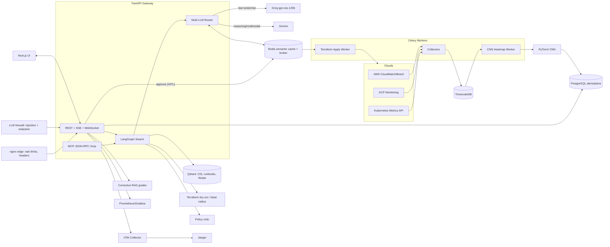

# CloudPulse AI — Architecture

## Trust boundaries
- Credentials: Fernet-encrypted at column level; key from env/KMS, never logged.
- AuthN/Z: OAuth2 password flow → JWT; roles viewer < operator < admin.
- Remediation: every plan is dry-run first; blast radius above `BLAST_RADIUS_MAX` needs admin approval.
- Audit: append-only hash chain (`prev_hash`/`hash`) + DB trigger blocks UPDATE/DELETE.
- MCP exposes read + propose tools only. It cannot approve or apply.
